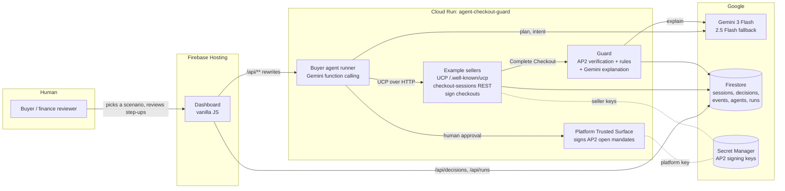
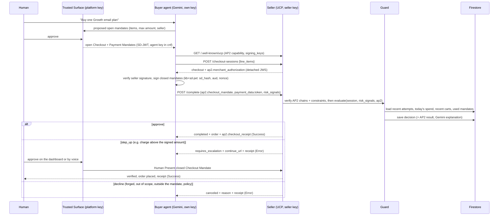
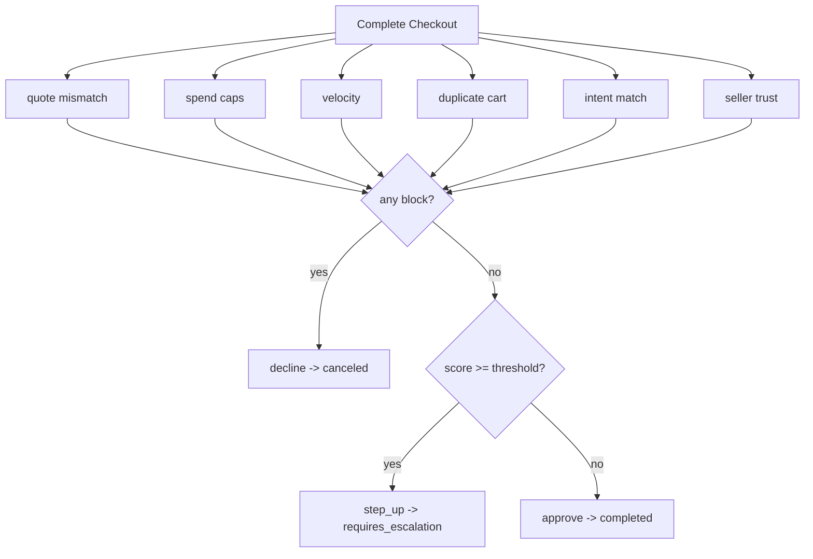

# Architecture

## Components

## Purchase flow (AP2 Human Not Present over UCP)

## Guard decision

## Data model (Firestore)

| Collection | Document | Written by | Read by |
|---|---|---|---|
| `sessions` | UCP checkout session plus `seller_id`, `agent_profile`, `quote_history`, `guard` | sellers, reviewer | sellers, Guard (duplicates, daily spend), dashboard |
| `decisions` | outcome, risk score, findings, explanation, timings, policy snapshot, AP2 result (status, mode, codes, approved limits), review (with voice evidence and Human Present mandate receipt) | Guard, reviewer | dashboard |
| `events` | append-only: created, updated, complete_attempt, canceled, review.resolved, review.voice_attempt, ap2.mandate_used | sellers, reviewer | Guard (velocity, AP2 mandate reuse) |
| `agents` | per-agent policy (caps, limits, threshold) | dashboard | Guard |
| `runs` | agent run trace (steps, outcomes) | agent runner | dashboard |

## Why the Guard sits at Complete Checkout

UCP already defines `risk_signals` as an input to Complete Checkout and defines `requires_escalation` with `continue_url` as a session state. UCP's AP2 extension makes the same call carry cryptographic proof of what the human authorised, so the Guard can check signed facts (merchant, items, maximum amount, this exact checkout) before it weighs behavioural signals. That gives a risk layer a standard place to receive context from the platform and a standard way to hand a purchase to a human, without inventing a side channel. The same Guard can run inside a seller's UCP implementation (as here), as a platform-side pre-check before the platform calls the seller, or as a hosted service that issuers and buyer platforms call.
